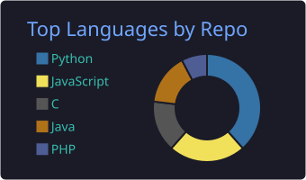
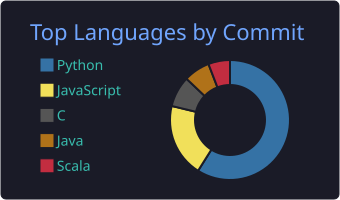
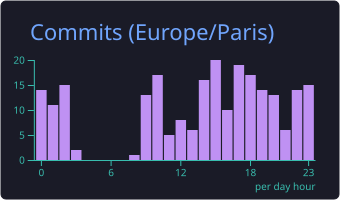
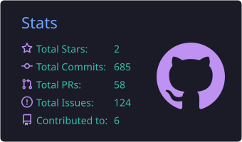
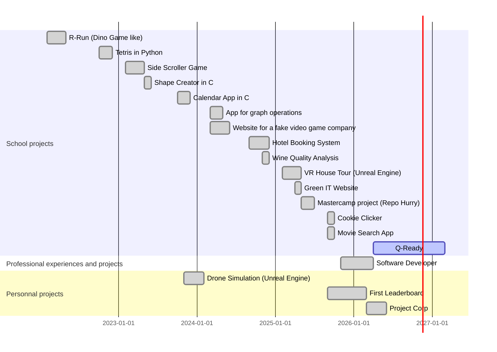

## About Me

- 💻 **Software Developer** specializing in Python
- 🎬 **Streamer** and former **e-sport caster**
- 🎓 **Student** pursuing a Master's degree in Computer Science and Software Engineering 
- 📚 **Currently learning**: C++ and C#
- 🎯 **Unreal Engine 5** developer

 

**Worked previously for:**

- <a href="https://www.linkedin.com/company/visionairy"> Visionairy</a> (Nov 2025 - Apr 2026): as a software developer tasked with converting their AI computer vision application, originally designed for Linux, into a Windows/Linux-compatible application. Mostly used Python and Powershell.

**Working on:**

- <a href="https://github.com/Rowuni/Q-Ready-Public">Q-Ready</a>: Development of post-quantum-ready software for the analysis and migration of cryptographic assets. As the project lead, I organise the team’s tasks and manage the security of the codebase, whilst also working as a developer. Public version available <a href="https://github.com/Rowuni/Q-Ready-Public">here</a>

 

## Tech Stack

<b>Core skills</b>

<table align="center">
<tr>
    <td align="center" width="96">
        
         Python
    </td>
    <td align="center" width="96">
        
         JavaScript
    </td>
    <td align="center" width="96">
        
         TypeScript
    </td>
    <td align="center" width="96">
        
         Java
    </td>
    <td align="center" width="96">
        
         PowerShell
    </td>
    <td align="center" width="96">
        
         SQLite
    </td>
</tr>
</table>

<table align="center">
<tr>
    <td align="center" width="96">
        
         HTML5
    </td>
    <td align="center" width="96">
        
         CSS3
    </td>
    <td align="center" width="96">
        
         Git
    </td>
    <td align="center" width="96">
        
         Docker
    </td>
    <td align="center" width="96">
        
         Unreal Engine
    </td>
</tr>
</table>

<b>Also used</b>

<table align="center">
<tr>
    <td align="center" width="96">
        
         C
    </td>
    <td align="center" width="96">
        
         PHP
    </td>
    <td align="center" width="96">
        
         Django
    </td>
    <td align="center" width="96">
        
         FastAPI
    </td>
    <td align="center" width="96">
        
         Node.js
    </td>
        <td align="center" width="96">
        
         Vue.js
    </td>
    
</tr>
</table>

<table align="center">
<tr>
    <td align="center" width="96">
        
         MongoDB
    </td>
    <td align="center" width="96">
        
         MySQL
    </td>
    <td align="center" width="96">
        
         Unity
    </td>
</tr>
</table>

## GitHub Statistics (Refreshed each day)

  
  

  
  

## 📚 Projects and experiences Roadmap

 Last updated: November 2026 

